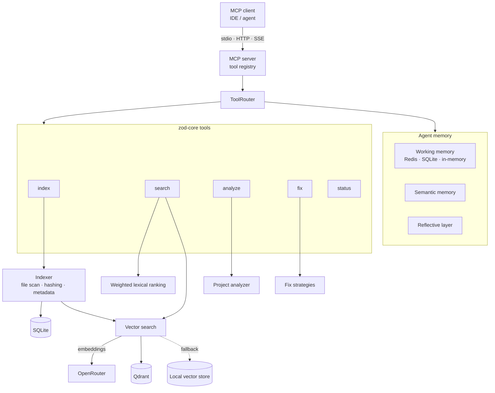

# ZOD MCP Server

> A modular Model Context Protocol (MCP) server that turns a codebase into a queryable knowledge base: project indexing, semantic vector search, static analysis, rule-based auto-fixes and a layered agent memory, all exposed as MCP tools over stdio, HTTP or SSE.


Built on the open-source [`instructa/mcp-starter`](https://github.com/instructa/mcp-starter) scaffold (MIT) and extended with the indexing, search, analysis and memory subsystems described below.

---

## Architecture Overview

The server is organized as a **plugin-oriented, layered architecture**. MCP tools are thin handlers; the real work lives in a core layer that is independent of the transport.



**Layering** (under `src/`):

| Layer | Responsibility |
| :-- | :-- |
| `core/` | Indexer, vector search, lexical search, SQLite persistence, config/env management, caching, plugin manager |
| `tools/zod-core/` | MCP-facing tools: index, search, analyze, fix, status, plus the router and memory layers |
| `plugins/` | Extension points (agent, project-analysis, visualization) loaded through a plugin manager |
| `shared/` | Dependency-injection service container, logging service, typed error model |

---

## Key Features

### 1. Pluggable vector retrieval with graceful degradation
Embeddings are generated through OpenRouter and stored in **Qdrant** using cosine distance, with separate `files` and `pages` collections created to match the embedding dimension. If embeddings or the vector database are unavailable, the system **degrades to an embedded local vector store or returns no semantic results instead of throwing**, so lexical search keeps working.

### 2. Rule-based, reviewable auto-fix engine
`core-fix` applies a catalogue of 12+ named fix strategies (for example `remove-console-log`, `fix-loose-equality`, `replace-any-with-unknown`, `fix-eval-usage`, `fix-async-foreach`, `fix-innerhtml-usage`, plus Python rules such as `fix-bare-except`). Each strategy is an isolated unit, which makes the engine easy to extend and its changes predictable.

### 3. Tiered agent memory
The memory subsystem separates **working memory** (a provider interface with Redis, SQLite and in-memory implementations selected by a factory), **semantic memory** and a **reflective layer** for reasoning over results. Backends are swappable behind one interface.

### 4. Multi-transport MCP surface
The same tool set can be served over **stdio**, **HTTP** or **SSE**, with dev scripts that wire in the MCP Inspector. The server tracks its registered tools for introspection and testing.

### 5. Test coverage at two levels
About 120 Vitest cases across 16 spec files: unit tests for the indexer and vector search, and integration tests for the analyze, explain, fix, index, search and status flows, including edge cases and a cross-workflow scenario.

---

## Tech Stack & Rationale

| Technology | Why it was chosen |
| :-- | :-- |
| **TypeScript (strict typing) + ESM** | Typed tool contracts and a compile-time safety net across a large multi-module codebase. |
| **@modelcontextprotocol/sdk** | Reference implementation of MCP, giving standards-compliant transports and tool schemas. |
| **Zod** | Runtime validation of tool inputs, matching the typed schemas exposed to clients. |
| **Qdrant** | Purpose-built vector database with cosine search and payload filtering. |
| **SQLite** | Zero-ops structured storage for indexed file metadata and local persistence. |
| **Redis (optional)** | Fast shared working memory when available, with SQLite and in-memory fallbacks. |
| **OpenRouter** | Single gateway to multiple embedding models, so the model is configurable rather than hard-wired. |
| **Vitest** | Fast TypeScript-native test runner with a coverage option. |
| **unbuild / tsx** | Quick builds for the published CLI and fast local development. |

---

## Getting Started

```bash
git clone https://github.com/NURJAKS/ZOD-mcp-server.git
cd ZOD-mcp-server
npm install
cp env.example .env     # configure embeddings / optional Qdrant & Redis
npm run build

npm run dev-stdio       # stdio transport + MCP Inspector
npm run dev-http        # HTTP transport on :4200
npm run dev-sse         # SSE transport on :4201
npm test                # Vitest suite
```

---

## Known Limitations & Roadmap

- The lexical ranking uses fixed heuristic weights (path 0.4, content 0.4, language 0.1, term matches 0.1); it does not yet fuse scores with the vector results.
- File hashing in the indexer is a lightweight 32-bit hash; moving to a cryptographic hash (`crypto`) is a planned improvement.
- Several top-level modules are large (for example `core-index.ts`, 1.7k lines) and are candidates for splitting.
- Some package metadata is still scaffold placeholders and should be rebranded before publishing.
- The `Dockerfile` is currently empty; a multi-stage container image is a planned addition.
- Debug scripts and sample index files at the repository root should move under `scripts/` or be removed.

## License

MIT
